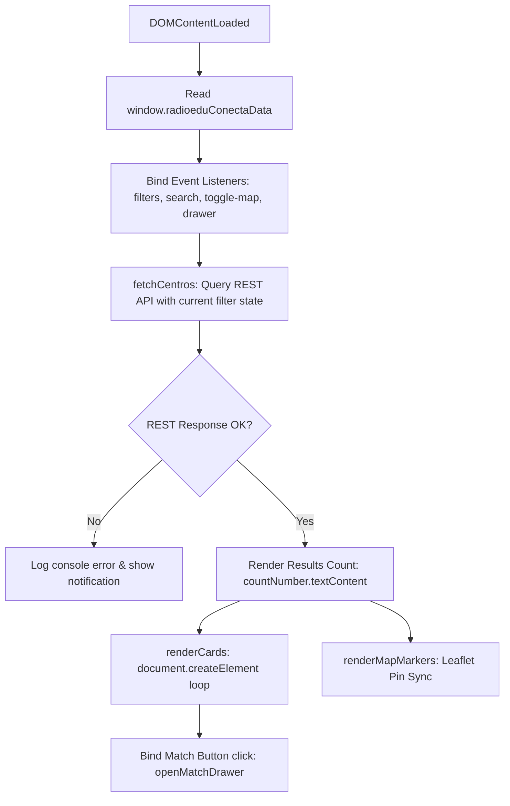

# ARCHITECTURE & TECHNICAL SPECIFICATION: RadioEdu Conecta

> **AI System Note:** This document provides a comprehensive, deterministic, machine-readable architectural blueprint of the `radioedu-conecta` WordPress plugin. It details runtime lifecycles, data contracts, security mitigaciones, frontend pipelines, and Architecture Decision Records (ADRs) for any artificial intelligence or human engineer contributing to this repository.

---

## 1. System Metadata & Project Overview

```yaml
system_id: radioedu-conecta
display_name: RadioEdu Conecta (Traspasando Fronteras)
version: 1.0.0
php_version_requirement: ">=8.1"
wp_version_requirement: ">=6.5"
tested_up_to: "6.7"
license: GPL-2.0-or-later
text_domain: radioedu-conecta
psr4_namespace: RadioEdu\Conecta\
target_environment:
  - WordPress Single Site
  - WordPress Multisite (Educarex Network)
governing_standard:
  - WordPress Coding Standards (WPCS)
  - PHPStan Level 6+
  - Plugin Check (PCP - WordPress.org)
  - WCAG 2.2 AA Accessibility
  - RGPD / GDPR EU 2016/679
institutional_context:
  entity: RadioEdu - Consejería de Educación, Ciencia y Formación Profesional
  government: Junta de Extremadura (Spain)
  portal: https://radioedu.educarex.es
```

### Purpose & Value Proposition
**RadioEdu Conecta** is the official collaborative platform for the **Traspasando Fronteras** initiative. It enables primary, secondary, and vocational schools across Extremadura (Spain) and worldwide to:
1. Publicly register and showcase their school radio station profile, equipment, genres, and educational stages.
2. Discover partner stations via a faceted real-time filter directory and an interactive geographical map.
3. Propose structured institutional twinning/collaboration ("Matches") without exposing personal coordinator contact information to the public web.

---

## 2. Directory Tree & File Inventory

```text
c:\radioedu-conecta\
├── radioedu-conecta.php                 # Main plugin entrypoint, WP.org headers, bootstrap & fallback autoloader
├── uninstall.php                        # Idempotent cleanup script for Single Site & Multisite uninstall
├── readme.txt                           # WordPress.org standard metadata & repository documentation
├── README.md                            # GitHub repository documentation
├── ARCHITECTURE.md                      # [THIS FILE] Machine-readable technical & architectural specification
├── BRIEFING.md                          # Functional & UX requirements derived from initial institutional mockup
├── AGENTS.md                            # Development rules, security directives, and DoD
├── TESTING-PROTOCOL.md                  # Test suites, Docker topology, and verification scripts
├── composer.json                        # PSR-4 autoload definition & dev dependencies
├── package.json                         # npm script configurations (@wordpress/scripts)
├── .distignore                          # Build exclusion rules for release distribution
├── .gitignore                           # Git repository exclusions
├── docker-compose.test.yml              # Local testing environment on port 8090 (WP 6.7 + MariaDB 10.11)
├── radioedu-conecta.zip                 # Production release archive (pre-compiled, ~99 KB)
├── src/
│   ├── Plugin.php                       # Core singleton orchestrator (lifecycle, hooks, DB schema check)
│   ├── Admin/
│   │   ├── CentroMetaBoxes.php          # Metaboxes for CPT (coordinates, logo upload, RGPD emails, podcast)
│   │   ├── ColaboracionesAdminPage.php  # Admin panel to view, accept, or decline match proposals
│   │   ├── DemoDataImporter.php         # Demo stations importer & synchronizer
│   │   └── Settings.php                 # WordPress Settings API options (map defaults, notification flags)
│   ├── Capabilities/
│   │   └── RoleCapabilities.php         # Custom capabilities management for admin, editor, and author roles
│   ├── Database/
│   │   └── ColaboracionesTable.php      # Custom table DDL via dbDelta() and DB lifecycle management
│   ├── Emails/
│   │   └── NotificationService.php      # wp_mail() notification pipeline for proposals and match responses
│   ├── Frontend/
│   │   └── DirectorioShortcode.php      # Shortcode handler [radioedu_directorio] & asset enqueueing
│   ├── PostTypes/
│   │   └── CentroPostType.php           # Custom Post Type registration (`radioedu_centro`)
│   ├── Privacy/
│   │   └── PrivacyPolicy.php            # RGPD/GDPR personal data exporter, eraser, and policy notice
│   ├── Rest/
│   │   ├── CentrosController.php        # REST Controller (`GET /radioedu-conecta/v1/centros`)
│   │   └── ColaboracionesController.php # REST Controller (`POST|PATCH|GET /radioedu-conecta/v1/colaboraciones`)
│   └── Taxonomies/
│       └── TaxonomiesRegistrar.php      # 5 faceted taxonomies registration & query bindings
├── templates/
│   └── directorio.php                   # Frontend view template: Banner, Facet Bar, Grid, Map, Drawer modal
├── assets/
│   ├── css/
│   │   ├── admin.css                    # Styling for admin metaboxes and media uploader preview
│   │   ├── directorio.css               # Styling for directory UI, facet filters, card grid, drawer, sticky note
│   │   └── leaflet.css                  # Self-contained Leaflet 1.9.4 CSS (zero CDN)
│   └── js/
│       ├── admin.js                     # WP Media Uploader connector for radio station logo
│       ├── directorio.js                # Frontend reactive controller (DOM builder, Leaflet manager, Drawer)
│       └── leaflet.js                   # Self-contained Leaflet 1.9.4 JavaScript runtime (zero CDN)
├── languages/
│   └── radioedu-conecta.pot             # GNU gettext internationalization template
└── vendor/
    └── autoload.php                     # Composer generated PSR-4 class loader
```

---

## 3. Core Architectural Principles & Institutional Constraints

### 3.1 Zero Third-Party CDN Dependency (Firewall Compliance)
* **Context:** Extremadura's regional educational network (*Educarex*) operates behind strict institutional proxies and firewall rules that block external unverified CDNs (unpkg, cdnjs, Google CDNs). Furthermore, WordPress.org Official Guidelines forbid external asset calls without explicit consent.
* **Implementation:** The Leaflet map engine (`leaflet.js` v1.9.4, `leaflet.css` v1.9.4) and all assets are strictly vendored locally in `/assets/`. No dynamic font or script tags reference third-party domains.

### 3.2 Asymmetric RGPD / GDPR Privacy Model
* **Constraint:** School radio station coordinators are public school teachers; their email addresses must never be indexed, scraped, or visible in public DOM/JSON responses.
* **Implementation:**
  - Coordinators' emails and direct names are saved in `_radioedu_coordinador_email` and `_radioedu_coordinador_nombre` post meta.
  - `CentrosController::prepare_item_for_response()` **explicitly omits** these fields from public REST API payloads.
  - External coordinators interact with other schools exclusively through the platform's proposal system. The plugin dispatches transactional emails on the server side (`NotificationService`), revealing contact details only once a proposal is explicitly accepted.

### 3.3 Strict Output Escaping & Zero `innerHTML`
* **Server-side (PHP):** Strict "Late Escaping" rule. Variables are escaped at the exact moment of output using `esc_html()`, `esc_attr()`, `esc_url()`, or `wp_json_encode()`.
* **Client-side (JavaScript):** `assets/js/directorio.js` prohibits `innerHTML`. All dynamic card nodes, badges, and modals are assembled using `document.createElement()`, `setAttribute()`, and `textContent` to eliminate Cross-Site Scripting (XSS) vectors.

---

## 4. Data Models & Database Schemas

### 4.1 Custom Post Type: `radioedu_centro`
* **Registered in:** [src/PostTypes/CentroPostType.php](file:///c:/radioedu-conecta/src/PostTypes/CentroPostType.php)
* **Features:** `title`, `editor` (station description), `thumbnail` (station header/cover image), `excerpt` (brief intro), `revisions`.
* **Icon:** `dashicons-format-audio`.
* **REST Visibility:** `show_in_rest => true` with `rest_base => radioedu_centros`.

#### Meta Keys Schema (`wp_postmeta`)
| Meta Key | Data Type | Sanitization / Validation | Description | Public in REST? |
| :--- | :--- | :--- | :--- | :--- |
| `_radioedu_logo_id` | `int` | `absint()` | Attachment ID for the circular radio station logo | Yes (URL) |
| `_radioedu_bandera` | `string` | `sanitize_key()` | Region/Country flag code (e.g., `es-ex`, `es-an`, `pt`, `fr`) | Yes |
| `_radioedu_lat` | `float` (stored as `string`) | `(string)(float)$val` | Latitude coordinates for Leaflet map pin | Yes |
| `_radioedu_lng` | `float` (stored as `string`) | `(string)(float)$val` | Longitude coordinates for Leaflet map pin | Yes |
| `_radioedu_podcast_url` | `string` (URL) | `esc_url_raw()` | External RSS / iVoox / Educarex podcast feed URL | Yes |
| `_radioedu_web_centro` | `string` (URL) | `esc_url_raw()` | Official school website URL | Yes |
| `_radioedu_edades` | `string` | `sanitize_text_field()` | Student age range (e.g. `10-14 años`) | Yes |
| `_radioedu_coordinador_nombre` | `string` | `sanitize_text_field()` | Full name of teacher coordinator | **NO (Admin only)** |
| `_radioedu_coordinador_email` | `string` | `sanitize_email()` | Notification email address of coordinator | **NO (Admin only)** |
| `_radioedu_disponible_colaborar`| `string` (`'1'` or `'0'`) | `'1' === $val ? '1' : '0'` | Availability flag for receiving new match proposals | Yes (Boolean) |

### 4.2 Faceted Taxonomies
* **Registered in:** [src/Taxonomies/TaxonomiesRegistrar.php](file:///c:/radioedu-conecta/src/Taxonomies/TaxonomiesRegistrar.php)
* All bound to post type `radioedu_centro`:
  1. `radioedu_etapa` (`hierarchical => true`): Educational stage (Infantil, Primaria, Secundaria, Bachillerato, FP, Universidad).
  2. `radioedu_idioma` (`hierarchical => false`): Broadcast language (Castellano, Inglés, Francés, Portugués, Bilingüe).
  3. `radioedu_tematica` (`hierarchical => false`): Content themes (Ciencia y Tecnología, Historia, Literatura, Medio Ambiente, Igualdad).
  4. `radioedu_formato` (`hierarchical => false`): Audio formats (Entrevistas, Informativos, Ficción Sonora, Magacín, Tertulias).
  5. `radioedu_localizacion` (`hierarchical => true`): Geographical taxonomy (España > Extremadura > Cáceres / Badajoz; Internacional > Portugal, etc.).

### 4.3 Custom Database Table: `{$wpdb->prefix}radioedu_colaboraciones`
* **Managed in:** [src/Database/ColaboracionesTable.php](file:///c:/radioedu-conecta/src/Database/ColaboracionesTable.php)
* **Schema Definition (MySQL / MariaDB via `dbDelta`):**

```sql
CREATE TABLE {$wpdb->prefix}radioedu_colaboraciones (
    id bigint(20) unsigned NOT NULL AUTO_INCREMENT,
    centro_emisor_id bigint(20) unsigned NOT NULL,
    centro_receptor_id bigint(20) unsigned NOT NULL,
    usuario_emisor_id bigint(20) unsigned NOT NULL,
    idea_proyecto text NOT NULL,
    curso_edades varchar(100) NOT NULL DEFAULT '',
    idiomas varchar(100) NOT NULL DEFAULT '',
    fechas_aprox varchar(150) NOT NULL DEFAULT '',
    estado varchar(20) NOT NULL DEFAULT 'pendiente',
    respuesta_mensaje text DEFAULT NULL,
    created_at datetime NOT NULL,
    updated_at datetime NOT NULL,
    PRIMARY KEY  (id),
    KEY centro_emisor_id (centro_emisor_id),
    KEY centro_receptor_id (centro_receptor_id),
    KEY usuario_emisor_id (usuario_emisor_id),
    KEY estado (estado)
) {$charset_collate};
```

* **State Machine for `estado` column:**
  ```text
  [pendiente] ──(PATCH by target coordinator)──► [aceptada]
              └──(PATCH by target coordinator)──► [rechazada]
  ```

---

## 5. Security & Authorization Matrix

### 5.1 Capabilities Matrix
* **Configured in:** [src/Capabilities/RoleCapabilities.php](file:///c:/radioedu-conecta/src/Capabilities/RoleCapabilities.php)

| Capability | Administrator | Editor | Author (Coordinator) | Subscriber / Visitor |
| :--- | :---: | :---: | :---: | :---: |
| `manage_radioedu` | ✅ | ❌ | ❌ | ❌ |
| `edit_radioedu_centros` | ✅ | ✅ | ✅ | ❌ |
| `edit_published_radioedu_centros` | ✅ | ✅ | ✅ | ❌ |
| `publish_radioedu_centros`| ✅ | ✅ | ✅ | ❌ |
| `delete_radioedu_centros` | ✅ | ✅ | ✅ | ❌ |
| `delete_published_radioedu_centros` | ✅ | ✅ | ✅ | ❌ |
| `edit_others_radioedu_centros` | ✅ | ✅ | ❌ | ❌ |
| `delete_others_radioedu_centros` | ✅ | ❌ | ❌ | ❌ |
| `propose_radioedu_colaboracion` | ✅ | ✅ | ✅ | ❌ |

---

## 6. REST API Contracts & Endpoints

### 6.1 `GET /wp-json/radioedu-conecta/v1/centros`
* **Permission:** Public (`__return_true`), strictly validated and sanitized.
* **Query Parameters:**
  - `page` (`int`, default: 1): Current page.
  - `per_page` (`int`, default: 24, max: 100): Centros per page.
  - `search` (`string`): Free-text search matching title/description.
  - `orden` (`enum`: `afines`, `recientes`, `alfa`): Ordering criteria.
  - `etapa` (`string`): Taxonomy slug for educational stage.
  - `idioma` (`string`): Taxonomy slug for language.
  - `tematica` (`string`): Taxonomy slug for content theme.
  - `formato` (`string`): Taxonomy slug for audio format.
  - `ubicacion` (`string`): Taxonomy slug for geographic location.
* **Success Response (HTTP 200):**
```json
{
  "centros": [
    {
      "id": 5,
      "nombre": "Radio Alconchel - CEIP Ntra Sra de la Luz",
      "descripcion": "Emisora escolar centrada en el patrimonio cultural y la naturaleza.",
      "foto_cabecera": "http://localhost:8090/wp-content/uploads/2026/10/cover.jpg",
      "logo_radio": "http://localhost:8090/wp-content/uploads/2026/10/logo.png",
      "bandera": "es-ex",
      "ubicacion": "Badajoz, Extremadura, España",
      "lat": "38.5172",
      "lng": "-7.1064",
      "podcast_url": "https://radioedu.educarex.es/radioalconchel",
      "web_centro": "https://cpnsdelaluz.educarex.es",
      "edades": "6-12 años",
      "disponible": true,
      "tags": [
        { "name": "Magacín", "slug": "magacin", "type": "formato", "color": "mint" },
        { "name": "Medio Ambiente", "slug": "medio-ambiente", "type": "tematica", "color": "coral" },
        { "name": "Primaria", "slug": "primaria", "type": "etapa", "color": "blue" }
      ],
      "enlace_perfil": "http://localhost:8090/radioedu-centros/radio-alconchel/"
    }
  ],
  "total": 6,
  "total_pages": 1,
  "page": 1,
  "per_page": 24
}
```

### 6.2 `POST /wp-json/radioedu-conecta/v1/colaboraciones`
* **Permission:** Authenticated user with `current_user_can('propose_radioedu_colaboracion')`.
* **Rate Limiting:** Maximum 10 proposals per user per hour (tracked via transient `radioedu_rate_{user_id}`). Returns `HTTP 429` if exceeded.
* **Request Payload (JSON):**
```json
{
  "centro_emisor_id": 5,
  "centro_receptor_id": 8,
  "idea_proyecto": "Queremos hacer un podcast conjunto sobre leyendas de Extremadura y Portugal.",
  "curso_edades": "10-12 años (5º y 6º Primaria)",
  "idiomas": "Castellano y Portugués",
  "fechas_aprox": "Segundo trimestre escolar (Enero - Marzo)"
}
```
* **Validation Rules:**
  - `centro_emisor_id` !== `centro_receptor_id` (cannot propose to self).
  - Both centers must exist with `post_status === 'publish'`.
  - `idea_proyecto` cannot be empty.
* **Success Response (HTTP 201):**
```json
{
  "success": true,
  "message": "¡Propuesta de match enviada con éxito!",
  "id": 14
}
```

### 6.3 `PATCH /wp-json/radioedu-conecta/v1/colaboraciones/{id}`
* **Permission:** Target station coordinator (`current_user_can('edit_post', $centro_receptor_id)`) or Super Admin (`manage_radioedu`).
* **Request Payload (JSON):**
```json
{
  "estado": "aceptada",
  "respuesta": "¡Encantados de colaborar! Os escribo a vuestro correo para coordinar los guiones."
}
```
* **Result:** Updates table record, sets `updated_at`, triggers `NotificationService::send_status_update_email()`.

---

## 7. Frontend UI / UX Pipeline & Lifecycle

### 7.1 Architecture of the Reactive Directory (`directorio.js`)



### 7.2 Drawer Offcanvas Workflow
1. User clicks **"Proponer match"** on a station card.
2. If visitor is **unauthenticated**, the drawer shows a login prompt notice redirecting to `/wp-login.php`.
3. If user is **authenticated**:
   - The drawer opens smoothly (`.radioedu-drawer-open` applied to panel and backdrop).
   - Target station ID and name are pre-populated into `#radioedu-match-receptor`.
   - Emisor center dropdown is selected to the user's coordinator center.
4. On submission, client issues `fetch(restUrl + 'colaboraciones', { method: 'POST' })` with `X-WP-Nonce` header.
5. On HTTP 201, feedback notice shows success, form resets, and drawer closes after 2.5 seconds.

---

## 8. Architecture Decision Records (ADRs)

### ADR-001: Custom Table vs Custom Post Type for Proposals
* **Decision:** Store proposals in `{$wpdb->prefix}radioedu_colaboraciones` instead of a CPT `radioedu_match`.
* **Rationale:**
  1. *Security & Privacy:* Proposals contain direct private ideas, coordinator email trails, and status exchanges. Storing them in standard `wp_posts` exposes them to generic query exposure, REST discovery, and search indexing bugs.
  2. *Relational Integrity & Indexing:* Proposals have rigid relational requirements (`centro_emisor_id`, `centro_receptor_id`, `usuario_emisor_id`, `estado`). Custom indexes on these columns make queries 10x faster than post meta joins.
  3. *Uncluttered WP Admin:* Avoids bloating the core posts table in high-activity multisite networks.

### ADR-002: Inlined Config Data vs `wp_localize_script()` in FSE / Block Themes
* **Decision:** Inline `window.radioeduConectaData` directly in [templates/directorio.php](file:///c:/radioedu-conecta/templates/directorio.php) as `<script type="text/javascript">window.radioeduConectaData = ...</script>`.
* **Rationale:**
  - In WordPress 6.5+ Full Site Editing (FSE) block themes (such as Twenty Twenty-Five), calling `wp_localize_script()` inside a shortcode function execution happens *after* the footer or header script tags have already resolved their dependency arrays. This caused `window.radioeduConectaData` to be missing, breaking all dynamic queries.
  - Inlining the JSON-encoded payload ensures atomic availability before the deferred `directorio.js` script initializes.

### ADR-003: Conditional REST Nonce Header
* **Decision:** In `assets/js/directorio.js`, only attach the `X-WP-Nonce` header when `restNonce` is a non-empty string.
* **Rationale:**
  - WordPress Core REST API (`rest_cookie_check_errors()`) checks: if an admin/logged-in session cookie is present *and* an `X-WP-Nonce` header is supplied, but that header is empty or invalid, WordPress unconditionally responds with **HTTP 403 `Cookie check failed`**, even on public readable endpoints!
  - By omitting the header when unauthenticated or empty, public reads to `/centros` work seamlessly for all visitors.

### ADR-004: Local Leaflet Asset Bundling
* **Decision:** Bundle Leaflet 1.9.4 CSS and JS locally in `assets/`.
* **Rationale:**
  - Compliance with WordPress.org Official Guidelines (no third-party CDN tracking).
  - Compliance with Junta de Extremadura institutional network firewall restrictions.

### ADR-005: Fallback PSR-4 Autoloader
* **Decision:** Include a lightweight fallback autoloader in [radioedu-conecta.php](file:///c:/radioedu-conecta/radioedu-conecta.php) before loading `vendor/autoload.php`.
* **Rationale:**
  - Ensures the plugin functions even if uploaded directly to a server where `composer install` has not been executed, preventing fatal errors on site activation.

---

## 9. Multisite (Educarex) Lifecycle Specifications

* **Network Activation:**
  - When network-activated, [src/Plugin.php](file:///c:/radioedu-conecta/src/Plugin.php) iterates through all active sites via `get_sites()` with `switch_to_blog()`.
  - Executes table creation (`dbDelta`), role capability assignments, and rewrite flush on every sub-site.
* **New Site Creation:**
  - Listens to `wp_initialize_site` to automatically provision the custom table and capabilities when a new educational school site is spawned.
* **Uninstallation:**
  - Handled in [uninstall.php](file:///c:/radioedu-conecta/uninstall.php).
  - Iterates through all sites in the network to drop `{$wpdb->prefix}radioedu_colaboraciones`, purge options (`radioedu_conecta_db_version`, `radioedu_conecta_settings`), delete transients, and revoke custom capabilities from all roles.

---

## 10. Operational & Build Automation Playbook

### 10.1 Testing Environment (Docker on Port 8090)
* **Configuration:** [docker-compose.test.yml](file:///c:/radioedu-conecta/docker-compose.test.yml)
* **WordPress URL:** `http://localhost:8090`
* **Admin Credentials:** `admin` / `password123`
* **WP-CLI Execution:**
  ```powershell
  docker compose -f docker-compose.test.yml exec -u www-data wordpress wp <command>
  ```

### 10.2 Seeding Test Data (6 Sample Centers)
* Script located at [scratch/seed_test_data.php](file:///C:/Users/manuel.narvaez/.gemini/antigravity-ide/brain/6edc2d8e-5436-4134-ac60-1d6d59959bbc/scratch/seed_test_data.php).
* Execute via WP-CLI:
  ```powershell
  docker cp "C:\Users\manuel.narvaez\.gemini\antigravity-ide\brain\6edc2d8e-5436-4134-ac60-1d6d59959bbc\scratch\seed_test_data.php" radioedu-wordpress:/tmp/seed.php
  docker compose -f docker-compose.test.yml exec -u www-data wordpress wp eval-file /tmp/seed.php
  ```

### 10.3 Generating the Distributable Release ZIP
* Execution script: [scratch/build_zip.ps1](file:///C:/Users/manuel.narvaez/.gemini/antigravity-ide/brain/6edc2d8e-5436-4134-ac60-1d6d59959bbc/scratch/build_zip.ps1)
* Command:
  ```powershell
  powershell -ExecutionPolicy Bypass -File "C:\Users\manuel.narvaez\.gemini\antigravity-ide\brain\6edc2d8e-5436-4134-ac60-1d6d59959bbc\scratch\build_zip.ps1"
  ```
* Output: `c:\radioedu-conecta\radioedu-conecta.zip` (~99 KB).
