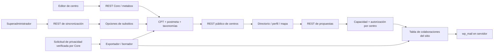

# Arquitectura, superficies y reproducción de la auditoría

## Documentación y skills aplicados

Leídos AGENTS.md, BRIEFING.md, ARCHITECTURE.md, README.md, readme.txt, TESTING-PROTOCOL.md, README de imágenes demo y configuración de desarrollo/CI. Se contrastaron con el código, no se trataron como garantía de comportamiento.

Skills de `C:/Users/manuel.narvaez/.agents/skills/`:

- `security-auditing-code-review/SKILL.md`, con metodología, checklist, plantilla de informe, clases de ataque y criterios de severidad.
- `wp-plugin-development/SKILL.md`.
- `wp-plugin-directory-guidelines/SKILL.md`, checklist de directrices y referencia de Plugin Check.
- `wp-phpstan/SKILL.md`.
- `rest-api-security/SKILL.md`.
- `multisite-security/SKILL.md`.
- `user-data-protection-privacy/SKILL.md`.

No se aplicaron skills de creación de sitios ni de diseño: se revisó el plugin existente. Los documentos se entregan como Markdown persistente en el repositorio.

## Arquitectura observada

`radioedu-conecta.php` define cabecera, constantes y autoload PSR-4, con alternativa local sin vendor. Arranca `Plugin` en `plugins_loaded`. En `init` se aprovisiona esquema si cambia la versión, después se registran CPT, meta, taxonomías, assets, bloque, plantilla e iconos. Hay 22 clases bajo `RadioEdu\Conecta`.

El directorio consulta datos públicos mediante REST propio. El editor guarda fichas y metadatos usando REST de Core; el editor clásico usa un metabox. Las propuestas se guardan en tabla propia y las respuestas pasan por un servicio compartido por REST y admin. Las notificaciones se envían en servidor. La sincronización de red lee opciones de subsitios y escribe fichas en el principal.



## Modelo de datos

| Almacén | Elementos | Frontera |
| --- | --- | --- |
| CPT | `radioedu_centro`, título, descripción, extracto, autor, imagen destacada, estado | Edición por capacidades de CPT; publicación del perfil |
| Taxonomías | `radioedu_etapa`, `radioedu_idioma`, `radioedu_tematica`, `radioedu_formato`, `radioedu_localizacion` | Datos públicos de filtrado/afinidad |
| Post meta editable | Logo ID, bandera, lat/lng, podcast, web, edades, nombre/email de coordinación, disponibilidad | Schema registrado y sanitizadores; contexto edit; capacidad por objeto |
| Post meta interno | `_radioedu_logo_url`, `_radioedu_cover_url`, `_radioedu_conecta_demo`, `_radioedu_source_blog_id` | No editable por REST; importador/sincronizador internos |
| Options del sitio | `radioedu_conecta_settings`, `radioedu_conecta_db_version`, `radioedu_conecta_directory_page_id` | Settings API/admin; versión del esquema 1.0.2 |
| Opción de red | `radioedu_conecta_sync_grant_author` | Preferencia del superadministrador |
| Transient | `radioedu_rate_{user_id}` | Contador horario del sitio; no atómico |
| User meta Core | Preferencia `radioedu-conecta/centroPanelOpened` | Estado del editor; residuo F-20 |
| Tabla propia | `{prefix}radioedu_colaboraciones` | Emisor/receptor/usuario emisor, idea, edades, idiomas, fechas, estado, respuesta, timestamps; no autor de respuesta |
| Navegador | `radioedu_favoritos` en localStorage; `radioedu_osm_consent` en sessionStorage | IDs/consentimiento por origen, no por blog |

## Endpoints y capacidades

Prefijo propio `/radioedu-conecta/v1`:

| Método/ruta | Acceso | Controles |
| --- | --- | --- |
| GET `/centros` | Público | Publicados, sin contraseña, datos de contacto omitidos, parámetros validados, per_page máximo 100 |
| POST `/colaboraciones` | Cuenta con capacidad del plugin | Gestión de emisor, receptor válido/disponible, distintos centros, longitud, cuota; nonce en autenticación cookie Core |
| GET `/colaboraciones` | Cuenta con capacidad | Filas del usuario/centros gestionados o global para manage_radioedu; topes F-05/F-06 |
| PATCH `/colaboraciones/{id}` | Receptor autorizado o gestor global | Estado permitido y UPDATE condicional pendiente; no repetición |
| POST `/network-sync` | `manage_network_options`, solo sitio principal | Multisite, offset no negativo, booleano de rol, lotes 1–100 |

Core añade `/wp/v2/centros` y rutas de las taxonomías. Los metadatos privados se muestran en edit únicamente a quien puede editar ese centro. No hay endpoints AJAX propios ni subidas propias; la biblioteca de medios es la de Core.

Capacidades persistidas (12): `manage_radioedu`, `edit_radioedu_centros`, `edit_others_radioedu_centros`, `edit_published_radioedu_centros`, `edit_private_radioedu_centros`, `publish_radioedu_centros`, `read_private_radioedu_centros`, `delete_radioedu_centros`, `delete_private_radioedu_centros`, `delete_published_radioedu_centros`, `delete_others_radioedu_centros`, `propose_radioedu_colaboracion`.

`create_radioedu_centros` es dinámica mediante `user_has_cap`: cuenta centros propios según ajuste. Administrador recibe todas; editor recibe las editoriales/propuestas salvo gestión global y borrado ajeno; autor edita/publica/borra los propios y propone. Suscriptor/colaborador no reciben capacidades del plugin. Los permisos de red usan capacidades de Core.

## Hooks

Inventario textual completo: `evidencias/hooks.txt`. Agrupación funcional:

- Arranque: `plugins_loaded`, `init` prioridades 0/1/5 y estándar; hooks de activación/desactivación registrados en fichero principal.
- CPT/meta: `rest_prepare_radioedu_centro`, `rest_pre_insert_radioedu_centro`, `save_post_radioedu_centro`, `add_meta_boxes`.
- REST: `rest_api_init`; filtro temporal `posts_clauses` acotado a la consulta de afinidad y retirado en finally.
- Capacidades: `user_has_cap`, `clean_post_cache`, `admin_notices`.
- Administración: `admin_menu`, `network_admin_menu`, `admin_init`, `admin_enqueue_scripts`, `enqueue_block_editor_assets`, filtro `option_page_capability_{grupo}` y `plugin_action_links_{basename}`.
- Formularios: `admin_post_radioedu_import_demo_data`, `admin_post_radioedu_respond_match`; nonce más capacidad antes de modificar.
- Frontend: `wp_enqueue_scripts`, `the_content` prioridad 20, `template_include`, `has_post_thumbnail`, `post_thumbnail_html`; shortcode `radioedu_directorio`, bloque `radioedu-conecta/directorio`.
- Privacidad: `wp_privacy_personal_data_exporters`, `wp_privacy_personal_data_erasers`, sugerencia mediante `wp_add_privacy_policy_content()`.
- Multisite: `wp_initialize_site`, `wpmu_drop_tables`. Este último usa el punto de extensión de Core para eliminar tablas; no se exige añadir además un borrado redundante en `wp_uninitialize_site`.
- Extensibilidad propia: `radioedu_conecta_network_sync_batch_size`, documentado, limitado a 1–100.

## Superficie de ataque y controles observados

| Entrada/salida | Mitigación observada | Límite de la conclusión |
| --- | --- | --- |
| Directorio anónimo | WP_Query, whitelist de orden/filtros, SQL preparado, exclusión de contactos | Sin benchmark de abuso a gran escala |
| REST de escritura | Capacidad + propiedad/gestión del centro; nonce cookie de Core | S-01/S-02 evaden cuotas, no identidad de centro ajeno |
| Metabox/formularios | Nonce, permisos, sanitizadores, redirect seguro y exit | Formularios admin completos no recorridos por HTTP en todas sus variantes |
| HTML y DOM | Escape por contexto, textContent/createElement, allowlist http/https y SVG | F-15 muestra un efecto funcional del saneamiento excesivo |
| SQL propio | Prepare, placeholders dinámicos solo generados internamente; insert/update con formatos | Integridad/carreras siguen teniendo F-04/F-07/F-19 |
| Medios/archivos | Selector Core, imagen y lectura del adjunto; includes locales constantes | Sin subida propia ni extracción de archivos |
| Correo | Solo servidor y destinatarios de centros, contacto tras aceptación | F-01/F-02/F-08; no se probó SMTP externo |
| Mapa | Leaflet local, consentimiento antes de teselas | Tiles bloqueadas en pruebas; no auditoría del proveedor |
| Multisite | Capacidad de red, switch/restore en finally, tablas por prefix | Caché F-18 y relación no única F-19 |

## Reproducir y completar verificaciones

Los scripts de `evidencias/` son sondas de auditoría para **entornos desechables**. Algunos crean datos, simulan errores SQL o ejecutan uninstall. No copiarlos al plugin distribuido ni ejecutarlos en los sitios 8090/8091 o en producción. Sus contraseñas y emails son ficticios.

Entorno ejecutado: Core 7.1.4, PHP 8.1.34, MariaDB 10.11, WP-CLI 2.12.0, Plugin Check 2.1.0, Edge 156; WP_DEBUG/WP_DEBUG_LOG/SCRIPT_DEBUG activos. Guard MU bloqueó wp_mail y HTTP externo. No se instalaron dependencias nuevas. Los recursos Docker temporales se retiraron al cerrar la auditoría.

Comandos de proyecto para un entorno de desarrollo con dependencias ya instaladas:

```text
composer lint:php
composer stan
vendor/bin/phpunit
npm run lint:js
npm run lint:css
npm run build
npm run test:e2e
composer audit --locked --format=json
npm audit --json
wp plugin check radioedu-conecta --require=/ruta/plugin-check/cli.php --format=json
wp i18n make-pot /ruta/radioedu-conecta /ruta/temporal/radioedu-conecta.pot
```

Para la auditoría se compiló con `--output-path artifacts/audit-build` y se compararon los ocho archivos con `build/`; idénticos. PHPCS se ejecutó desde la dependencia incluida en Plugin Check, con copia de las reglas del proyecto que omitía únicamente el estándar no instalado PHPCompatibilityWP. Esto acredita WPCS, no el comando completo `composer lint:php`.

Para E2E se usaron `WP_BASE_URL=http://localhost:8092`, cuenta ficticia nueva, `PLAYWRIGHT_CHANNEL=msedge`, un directorio sin otras fichas publicadas y favicon local. El primer intento mostró que los tests presuponen la ficha en la primera página y consideran error cualquier 404 de consola. Las fuentes de los tests no se cambiaron.

Pendientes necesarios para una entrega de código corregido: PHPUnit completo y su matriz, PHPStan nivel 6, PHPCompatibilityWP, regresiones de todos los hallazgos, perfil real con tema clásico, accesibilidad ampliada, caché persistente, SMTP simulado con fallo y pruebas de concurrencia HTTP. La CI declarada existe, pero no se consultó ni se certificó una ejecución remota.

*Actualización 2026-11-01.* De esa lista ya están hechos:

- PHPUnit completo, en sitio único y en multisitio, con PHP 8.1 y WordPress 7.1.4;
- PHPStan nivel 6 y PHPCompatibilityWP;
- regresiones para todos los hallazgos.

Siguen pendientes:

- la matriz de versiones;
- la caché persistente;
- el SMTP simulado con fallo;
- la concurrencia HTTP real. La carrera de F-19 se prueba con intercalado determinista, como hizo la auditoría.
- la CI remota.

El detalle está en «Seguimiento de correcciones» de INFORME.md.

## Distribución y despliegue posterior

No se produjo ni desplegó una versión nueva. El ZIP existente tiene 100 ficheros, 10.965.845 bytes descomprimidos y coincide byte a byte con los ficheros correspondientes del árbol auditado. No incluye vendor dev, node_modules, tests ni docs.

Antes del siguiente empaquetado: incorporar licencia Leaflet, resolver P1 y demás criterios DoD, excluir `docs/auditoria/` (ahora no cubierto por `.distignore`), usar una copia distribuible limpia y ejecutar PCP sobre esa copia. Añadir exclusiones defensivas para `.env`, `.env.*` y metadatos de herramientas: gitignore no es una política de distribución. No se encontró un `.env` real en la raíz revisada.

El despliegue debe usar un ZIP verificado y una copia de seguridad de datos, con ensayo previo de actualización/restauración. La revisión no autoriza ni realiza publicación en WordPress.org.
